메모리 할당을 직접 구현해 봤고, SQL도 배웠는데, 파일에 저장된 데이터를 메모리로 가져와 처리할 때 이 둘이 어떻게 연결되는지 궁금해 SQL을 해석하고 B+트리로 데이터를 찾아 읽고 쓰는 작은 SQL 엔진을 만들었습니다.

## SQL 한 문장이 파일에 닿기까지

SQL을 입력하면 데이터베이스는 문법을 분석하고 테이블과 컬럼을 확인한 뒤, 데이터를 찾을 방법을 정합니다. 실행기는 그렇게 만들어진 계획에 따라 데이터를 읽고 조건을 검사해 결과를 반환합니다.


위 SQL로 `users`에서 `id`가 `1`인 행을 읽으려면, 테이블이 저장된 위치와 그 안에서 행을 찾을 방법을 알아야 합니다. SQL에는 원하는 데이터의 조건만 적혀 있는데, `id = 1`만으로 행이 저장된 위치를 어떻게 찾을까요?

사용해 본 PostgreSQL을 기준으로 보면, SQL의 문법을 분석하고 테이블과 컬럼을 확인한 뒤 뷰 등의 규칙을 반영합니다. 이어서 플래너가 순차 조회와 인덱스 조회 등의 비용을 비교해 계획을 고르면, 실행기는 그 계획대로 데이터에 접근합니다. PostgreSQL은 클라이언트 연결과 동시 접근, 장애 복구도 함께 처리하며, 테이블 정보를 확인하는 의미 분석부터 트랜잭션 안에서 작업합니다.

그중 직접 구현해 보고 싶었던 것은 SQL의 조건으로 파일에서 행을 찾고, 읽어 온 바이트를 메모리에서 값으로 해석하는 경로였습니다. 네트워크 서버와 동시성 제어는 별도로 두고, 한 테이블의 생성·삽입·조회·수정·삭제가 파일 입출력까지 이어지도록 구현했습니다.

```text
[그림 설명: PostgreSQL의 처리 흐름]
위치: 구현한 엔진의 흐름 바로 위에 놓아 같은 단계를 위아래로 비교합니다.
흐름: SQL 수신 → 구문·의미 분석 → 뷰 등의 규칙 적용 → 계획 수립 → 실행 → 결과 반환.
저장 접근: 실행기가 인덱스와 테이블의 페이지에 접근하는 경로를 따로 연결합니다.
연결·트랜잭션·동시성·복구는 뒤에 붙는 한 단계가 아니라 관련 처리 전반을 감싸는 영역으로 표시합니다.
비교 목적: PostgreSQL 전체를 재현했다는 의미가 아니라, SQL 해석과 저장 계층을 중심으로 구현 범위를 구분합니다.
```

```text
[그림 설명: 구현한 엔진에서 SQL이 전달되는 경로]
흐름: REPL 입력 → 파서 → 규칙 기반 플래너 → 실행기 → B+트리·힙 → 페이지 버퍼·파일 입출력.
예시 SQL에서 users, 전체 컬럼(*), id의 동등 조건과 값 1이 분리되는 모습을 표시합니다.
플래너가 INDEX_LOOKUP을 선택하고 실행기에 키 1이 전달됩니다.
아래 계층은 자세히 펼치지 않습니다. 이 그림은 문장 해석과 실행 경로 선택까지 설명합니다.
```

## SQL을 실행할 정보로 바꾸기

이름과 나이를 저장하고 다시 조회하는 SQL을 따라가 보겠습니다.


저장한 행을 트리에서 찾으려면 기준이 될 키가 필요합니다. 별도의 `PRIMARY KEY` 선언 기능 대신, 행마다 증가하는 `id`를 엔진이 추가해 탐색 키로 사용했습니다. 첫 번째로 저장한 `Alice`에는 `1`이 부여되므로, 이후에는 `id = 1`로 같은 행을 찾을 수 있습니다.

이 조건을 트리 탐색에 사용하려면 SQL 문자열에서 비교 대상과 값을 구분해야 합니다. 파서가 테이블과 조건·값을 구분해 두면, 플래너가 `INDEX_LOOKUP`을 고르고 실행기는 해석된 값 `1`로 트리를 탐색합니다. 계획별 비용을 비교하는 대신 조건으로 경로를 고르도록 단순화했고, 키 탐색을 쓰지 않는 조건은 행을 순서대로 읽으며 검사합니다.

파일에서 읽은 바이트를 이름과 나이로 구분하려면 각 값의 시작점과 크기를 알아야 합니다. 행을 고정 길이로 저장하고 자료형·저장 폭·위치를 스키마에 기록해, 다시 읽을 때도 `id`, `name`, `age`로 해석할 수 있도록 했습니다.

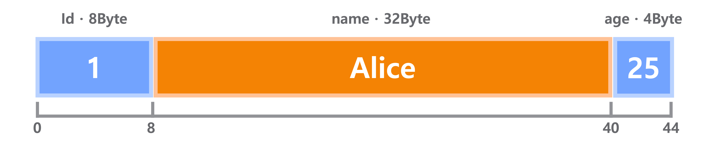

행을 메모리로 가져오려면 파일에서 읽고 보관할 단위도 필요합니다. 메모리 관리에서 배운 페이지 구조를 여기에 적용해 보고 싶었습니다.

## 메모리를 페이지로 나누어 관리하는 이유

프로그램들이 메모리를 사용하고 반납하는 동안, RAM의 빈 공간은 여러 곳에 나뉘어 생깁니다. 새로 필요한 메모리를 한곳에 이어서 배정해야 한다면, 남은 공간이 충분해도 그만큼 넓은 빈자리가 없을 수 있습니다.

프로그램이 사용하는 주소의 순서와 RAM에 배치되는 순서를 분리하면, 떨어진 빈 공간도 함께 사용할 수 있습니다. 운영체제는 가상 주소 공간을 일정한 크기의 페이지로, 물리 메모리를 같은 크기의 프레임으로 나누고 각 페이지가 어느 프레임에 있는지 관리합니다.

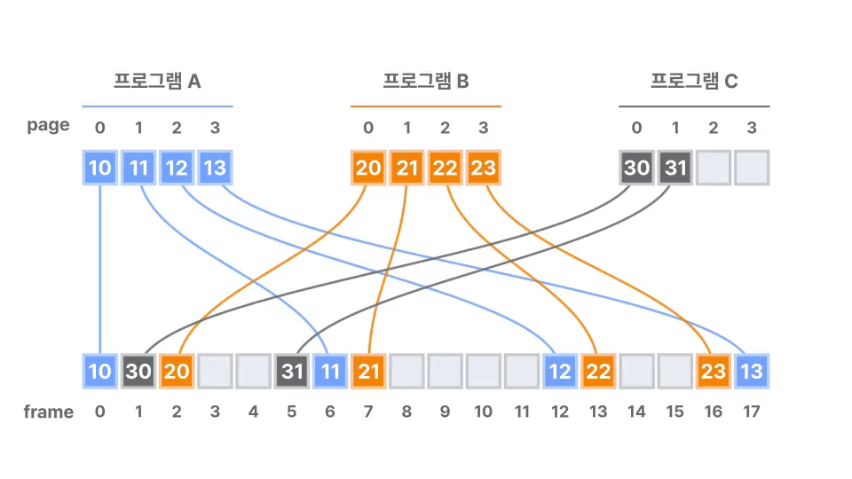

행 하나를 찾으려고 파일 전체를 읽으면 필요 없는 데이터까지 가져오고, 모두 보관하려면 메모리도 그만큼 차지합니다. 파일을 고정 크기의 DB 페이지로 나누고 번호를 붙여, 필요한 부분을 읽고 버퍼에서 다시 사용할 수 있도록 했습니다.

```text
[그림 설명: 한 행을 찾으려고 가져오는 데이터의 차이]
같은 파일과 같은 크기의 제한된 버퍼를 사용하는 두 경우를 비교합니다.
왼쪽: 파일 전체를 훑으며 여러 페이지를 차례로 읽습니다. 버퍼에 모두 남길 필요는 없습니다.
오른쪽: 탐색 구조로 필요한 페이지를 골라 읽고, 다시 요청한 페이지는 버퍼에서 재사용합니다.
파일을 읽은 양과 현재 버퍼에 보관한 양은 별도로 표시합니다.
결론: 전체 읽기와 전체 RAM 상주는 다르며, 읽을 범위를 좁히는 구조도 함께 필요합니다.
```

DB 페이지의 크기는 별도로 정할 수 있지만, 배운 단위를 적용하고 함께 탐색할 데이터를 모으는 기준으로 운영체제 페이지를 택했습니다. 새 DB를 만들 때 `sysconf(_SC_PAGESIZE)`로 읽은 값은 제 M4 맥북 에어에서 16KiB였고, 다시 열 때도 같은 크기로 읽도록 파일 헤더에 기록했습니다.

## 파일 탐색에 B+트리가 적합한 이유

파일을 페이지로 나누어도 원하는 행이 어디에 있는지 몰라 모든 페이지를 확인한다면, 결국 파일 전체를 읽게 됩니다. 행을 읽기 전에 탐색 범위를 좁힐 방법이 필요합니다.

정렬된 배열이라면 이진 탐색으로 키를 찾을 수 있습니다. 하지만 중간에 새 값을 넣으면 뒤쪽 항목을 옮겨야 하고, 배열이 파일의 여러 페이지에 걸쳐 있다면 여러 페이지를 수정하게 됩니다.

B트리는 정렬된 키를 여러 노드로 나누고, 노드 안의 경계값으로 다음 자식을 고릅니다. 한 노드에 여러 자식의 범위를 담으면 적은 수의 노드를 거쳐 원하는 키에 도달할 수 있습니다. 노드를 페이지에 맞춰 두면 읽어 온 페이지 안에서 다음 탐색 위치를 고를 수 있어, 파일 전체를 가져오지 않고 필요한 가지로 내려갈 수 있습니다.

일반적인 B트리는 내부 노드에도 레코드나 참조를 둘 수 있지만, B+트리는 이를 맨 아래의 리프에 모으고 내부 노드에는 경계 키와 자식 위치만 둡니다. 단건 조회뿐 아니라 범위 조회도 구현하고 싶었으므로, 시작 키를 찾은 뒤 연결된 리프를 따라갈 수 있는 B+트리를 선택했습니다.

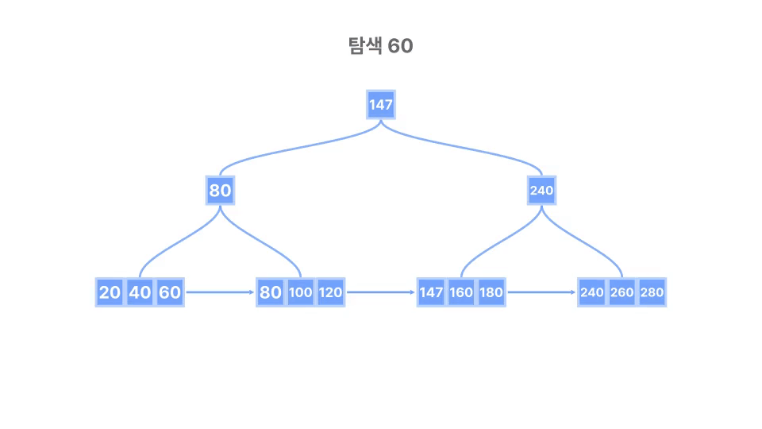

삽입할 때는 들어갈 리프에서 순서를 맞추고, 공간이 부족하면 리프를 나눠 부모에 새로운 경계를 추가합니다. 삭제 후 항목이 부족해지면 형제와 재분배하거나 병합합니다.

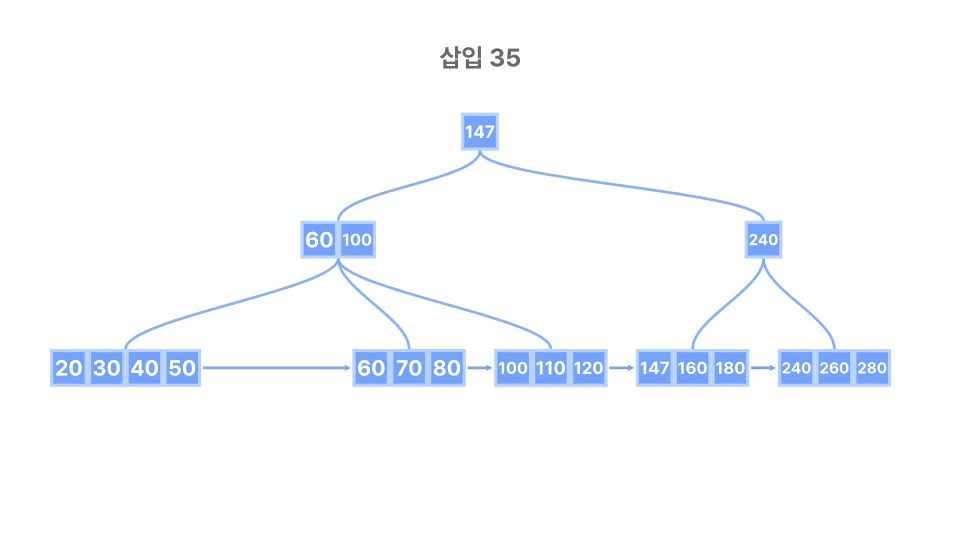

분할과 병합이 루트까지 이어질 수는 있지만, 배열처럼 삽입 위치 뒤의 데이터를 전부 옮기지 않고 관련 노드를 수정해 정렬을 유지합니다.

## 리프에는 행 대신 위치를 저장하기

리프에 행까지 넣으면 키를 정렬하거나 노드를 나눌 때 행 데이터도 함께 옮겨야 합니다. 그래서 키와 위치만 리프에 남기고 실제 행은 힙으로 분리했습니다. 한 페이지에 더 많은 키를 담는 대신, 조회할 때 힙 페이지를 한 번 더 요청합니다.

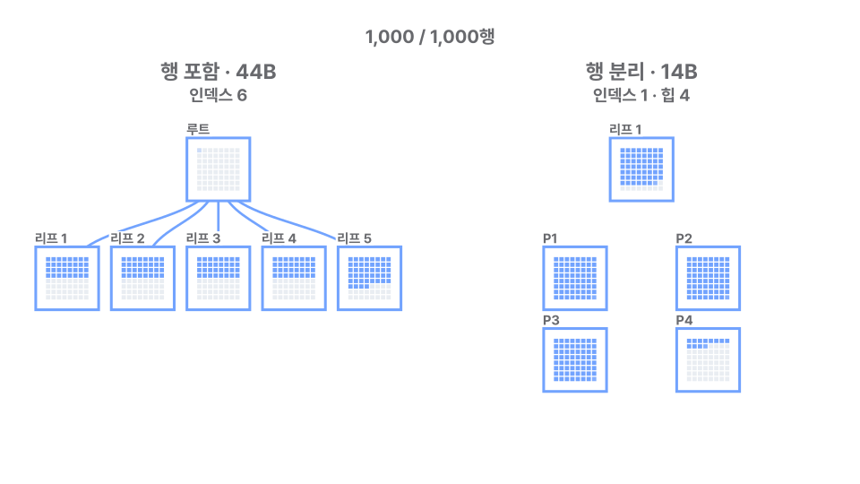

프로그램을 다시 실행해도 같은 행을 찾으려면 메모리 주소 대신 파일의 위치가 필요합니다. 트리에는 페이지 번호와 슬롯 번호를 묶은 행 참조를 저장했습니다.

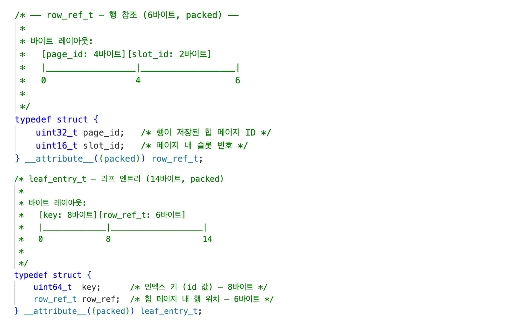

슬롯에는 페이지 안에서 행이 시작하는 위치를 기록합니다. 같은 슬롯에서 이름이나 나이를 수정하면 트리의 참조는 유지하고, 행의 키나 페이지·슬롯 번호가 바뀌면 트리도 갱신해야 합니다. 삭제한 슬롯은 빈 상태로 바꿔 다시 사용합니다.

## 노드 하나를 페이지 하나에 담기

키와 위치만 남긴 노드를 페이지 하나에 담으면 얼마나 많은 행을 찾을 수 있을까요? 헤더를 제외한 공간에 들어가는 항목 수로 계산해 봤습니다.

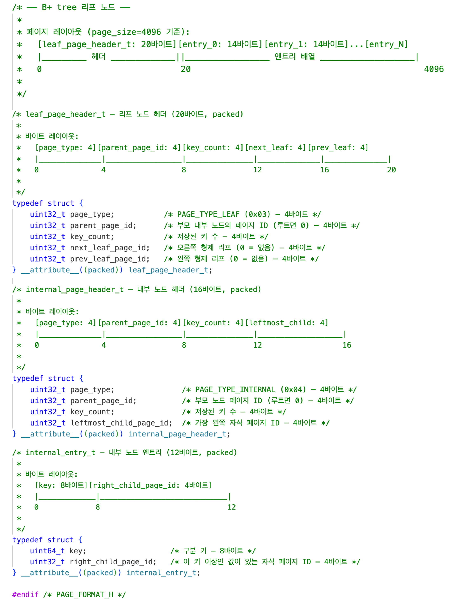

코드 주석의 배치는 4KiB 예시입니다. 실행 환경에서 읽은 16KiB를 대입하면 내부 노드는 헤더 16바이트를 뺀 공간에 12바이트 항목 1,364개를 담고, 헤더의 첫 자식까지 합쳐 최대 1,365개의 자식을 가리킵니다. 리프에는 헤더 20바이트를 제외한 공간에 14바이트 항목 1,168개가 들어갑니다. 루트·내부 노드·리프의 세 레벨을 가득 채우면 **1,365(루트 노드) × 1,365(내부 노드) × 1,168(리프) = 2,176,246,800개**, 약 21억 개의 키를 담을 수 있습니다.

트리가 깊어지면 키 비교뿐 아니라 요청할 페이지도 늘어납니다. 버퍼에 없는 노드는 파일에서 가져와야 하므로 한 페이지에 많은 키를 담아 트리를 낮게 유지하면 파일에 접근할 범위도 줄일 수 있습니다. 이미 읽은 페이지는 재사용하므로 세 레벨이 곧 저장장치 읽기 세 번을 뜻하지는 않습니다.

`id`를 기준으로 행의 위치를 찾는 이 트리가 인덱스입니다. 다른 컬럼에도 인덱스를 만들려면 그 키를 기준으로 한 탐색 구조를 따로 저장하고, 행이 바뀔 때 함께 갱신해야 합니다.

## 페이지 캐시와 파일 입출력 관리

같은 페이지를 요청할 때마다 파일을 읽지 않도록, 읽어 온 페이지를 버퍼에 남겨 트리와 힙이 함께 사용하게 했습니다. 버퍼의 조회·교체와 파일 입출력을 맡는 부분을 코드에서는 `Pager`라고 부릅니다.

버퍼에 없는 페이지는 파일의 `페이지 번호 × 페이지 크기` 위치에서 읽습니다. 같은 번호를 다시 요청하면 보관한 버퍼를 반환하고, 공간이 차면 사용 중이지 않은 페이지를 교체하도록 했습니다. 사용 중인 페이지에는 pin을 걸어 교체를 막고, 수정을 마친 페이지에는 dirty 표시를 남겨 교체하거나 변경 내용을 반영할 때 파일에 씁니다. `pread`와 `pwrite`는 DB 버퍼와 별개로 운영체제의 파일 캐시를 거칩니다.

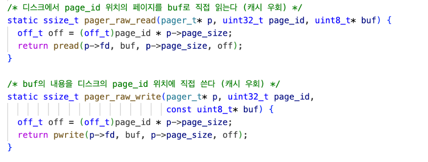

같은 페이지를 두 번 요청해 보니, 처음에는 파일을 읽고 다음에는 같은 프레임과 버퍼 주소를 반환했습니다.

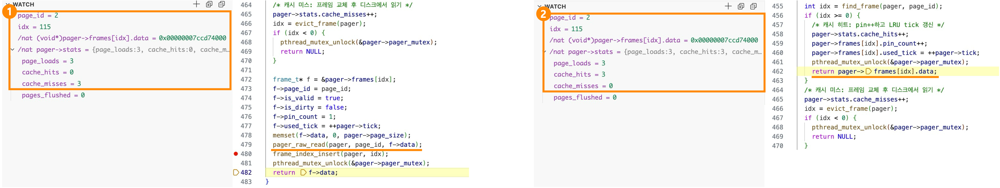

그렇다면 찾는 키가 흩어져 있어도 버퍼를 재사용할 수 있을까요? 100만 행 파일과 256프레임(4MiB) 버퍼에서 연속된 키·전체 범위 무작위·앞쪽 1% 무작위로 각각 5,000개 키를 두 번씩 조회하고, 난수 시드 5개로 반복했습니다.

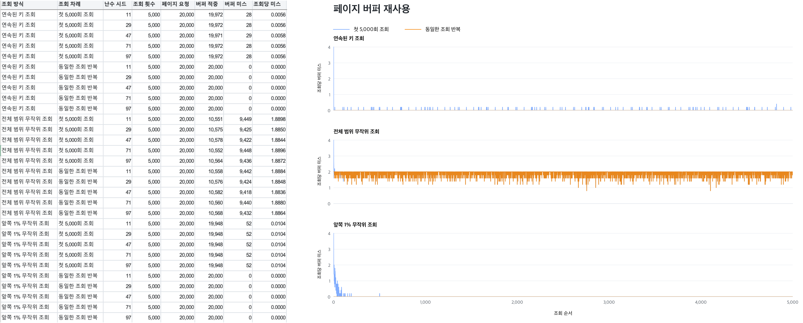

여기서 미스는 실제 저장장치 접근이 아니라 DB 버퍼에 페이지가 없는 횟수입니다. 연속된 키와 앞쪽 1%에 모인 키는 두 번째 조회에서 미스가 사라졌지만, 전체 범위 무작위 조회는 조회당 약 1.89회가 남았습니다. 같은 조회를 반복하더라도 재사용할 페이지가 버퍼에 남아 있어야 효과가 있었습니다.

## SQL에서 파일의 행을 읽기

프로그램을 다시 켰을 때도 시작점을 찾을 수 있도록, 페이지 크기와 스키마, 루트와 첫 힙 페이지의 위치를 파일 첫 페이지인 DB 헤더에 기록했습니다. 루트가 분할되면 바뀐 위치도 여기에 갱신합니다.

파일을 열어 헤더를 읽은 뒤, 처음의 `SELECT * FROM users WHERE id = 1`을 실행했습니다. 실행기는 플래너가 선택한 경로로 트리에서 키 `1`을 찾고, 리프에서 얻은 `page_id = 1, slot_id = 0`으로 힙 페이지를 요청합니다. 슬롯에 적힌 위치부터 읽으면 `Alice`를 저장한 행의 바이트에 도달합니다.

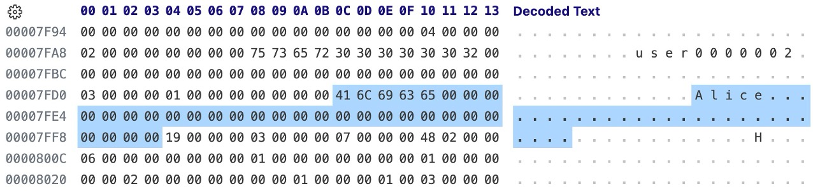

이 바이트에 스키마의 컬럼 위치와 자료형을 적용해 값을 해석하면 `1 | Alice | 25`가 됩니다. 디버거에서도 트리가 반환한 행 참조와 힙에서 읽어 해석한 값이 이어지는 것을 확인했습니다.

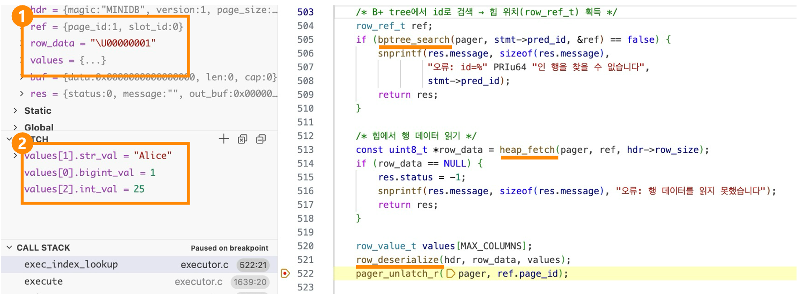

정상 종료 후 새 프로세스로 파일을 열어도 같은 행을 읽었습니다. 파일에 남긴 헤더와 페이지·슬롯 번호로 저장한 값을 되찾을 수 있었습니다.

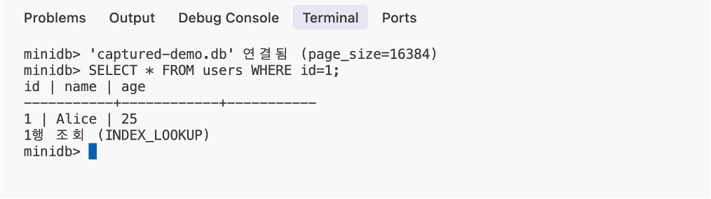

여러 페이지를 수정하다 중단됐을 때 일부만 기록된 내용을 복구하는 문제는 별도로 남아 있습니다.

## PostgreSQL과 비교한 결과

100만 행에서 삽입·단건·범위·전체 조회를 반복 측정하고, 작업별 기록을 진행률에 맞춰 그렸습니다. SQL 엔진은 macOS의 C API로, PostgreSQL 17은 Docker의 TCP 연결로 실행했습니다. 문장마다 커밋하는 PostgreSQL은 `fsync`를 켜거나 꺼서 비교했으며, SQL 엔진에는 트랜잭션·WAL·`fsync`가 없습니다.

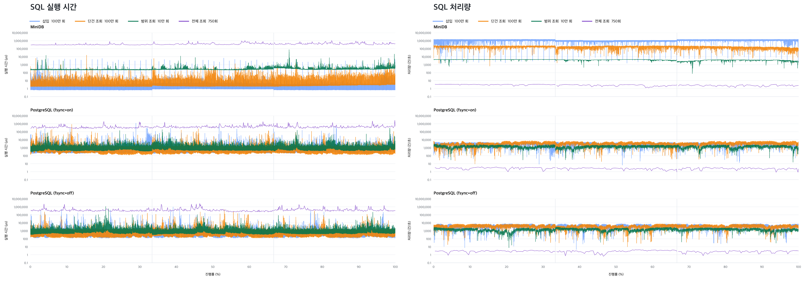

삽입·단건 조회는 SQL 엔진이 각각 0.75μs·5.92μs로 PostgreSQL보다 짧았습니다. PostgreSQL은 `fsync`를 켰을 때 273μs·239μs, 껐을 때 207μs·211μs였으며, 모두 실행 시간의 중앙값입니다. 다만 함수 호출과 TCP 통신·문장별 커밋까지 포함하므로 저장 구조만의 성능 차이로 볼 수는 없습니다.

1,000행 범위 조회는 SQL 엔진이 약 248μs, PostgreSQL이 573~583μs였고, 전체 조회는 각각 약 348ms와 350~375ms로 비슷했습니다. 범위 조회에서는 연결된 리프의 행 참조로 힙을 읽어, 처음 목표로 했던 리프 순회를 SQL 실행까지 연결했습니다.

PostgreSQL의 비용 기반 최적화나 동시성 제어까지 다루지는 않았지만, `id = 1`로 파일의 행을 찾아 `1 | Alice | 25`로 읽어 내는 SQL 엔진을 직접 만들면서 따로 배웠던 자료구조와 메모리 관리, 파일 입출력이 SQL의 결과를 만드는 데 어떻게 쓰이는지 확인할 수 있었습니다.
