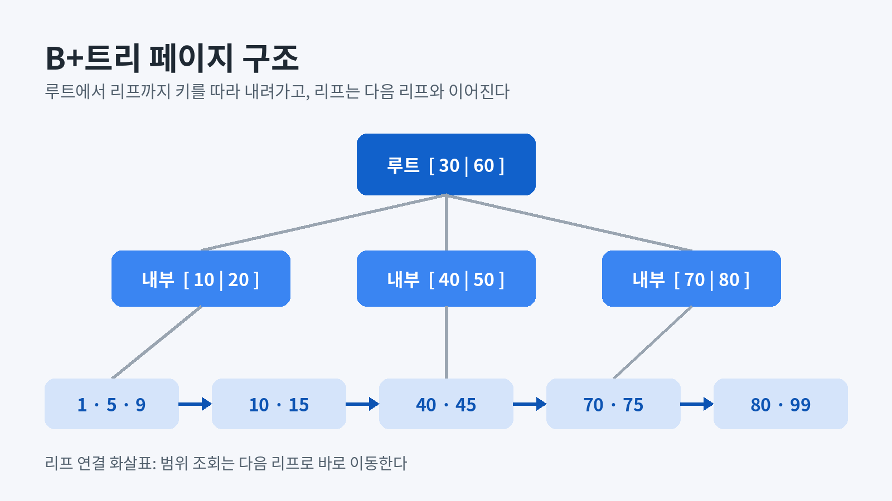
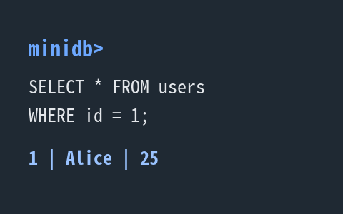

그림, 표, 코드 블록과 여러 Markdown 문법을 한 글에 모아 블로그 렌더러가 어떻게 보여 주는지 확인하는 데모 글입니다.

글의 소재는 작은 SQL 엔진입니다. `SELECT * FROM users WHERE id = 1;` 한 줄이 **파일의 바이트**까지 이어지는 과정을 따라가면서, 그 사이에 나오는 문법을 하나씩 씁니다.

## 페이지 구조 그림

본문보다 큰 그림은 본문 폭에 맞춰 줄어들고, 모서리는 코드 블록과 같은 곡률을 씁니다.



본문보다 작은 그림은 늘리지 않고 원래 크기로 가운데에 놓입니다.



## 인라인 서식

*기울임*, **굵게**, ***굵은 기울임***, ~~취소선~~, `인라인 코드`, ==형광 표시==를 한 문단에 섞어 씁니다. 화학식 H~2~O와 제곱 2^10^, 단축키 :kbd[⌘ Cmd] + :kbd[K]도 씁니다.

링크는 [CommonMark 명세](https://spec.commonmark.org/), 사이트 안 링크는 [검색](/search/)처럼 씁니다. 각주도 붙일 수 있습니다.[^page]

## 표

### 페이지 종류

| 페이지 | 담는 것 | 크기(바이트) | 다음 페이지 링크 |
|:-------|:--------|-------------:|:----------------:|
| 헤더 | 페이지 크기, 스키마, 루트 위치 | 100 | 없음 |
| 내부 | 키와 자식 페이지 번호 | 4,096 | 없음 |
| 리프 | 키와 행 참조 `(page, slot)` | 4,096 | 있음 |
| 힙 | 실제 행 바이트 | 4,096 | 없음 |

### 조회 방식 비교

| 조건 | 계획 | 읽는 페이지 수 | 설명 |
|:-----|:----:|------:|:-----|
| `id = 1` | `INDEX_LOOKUP` | 3 | 루트 → 내부 → 리프로 내려가 행 참조 하나를 얻습니다 |
| `id BETWEEN 10 AND 45` | `INDEX_RANGE` | 5 | 첫 리프를 찾은 뒤 다음 리프 링크를 따라 오른쪽으로 읽습니다 |
| `age > 20` | `FULL_SCAN` | 전체 | 인덱스가 없는 열이라 힙 페이지를 처음부터 끝까지 읽습니다. 표 칸 안의 아주 긴 설명은 줄을 바꿔 표시합니다 |

## 코드 블록

### SQL

```sql
CREATE TABLE users (name VARCHAR(32), age INT);
INSERT INTO users VALUES ('Alice', 25), ('Bob', 31);

-- 인덱스로 한 행 찾기
SELECT * FROM users WHERE id = 1;

-- 리프 연결로 범위 읽기
SELECT name, age FROM users WHERE id BETWEEN 10 AND 45 ORDER BY id;
```

### C

```c
/* 리프 페이지에서 키를 이분 탐색한다 */
static int leaf_find(const LeafPage *leaf, uint32_t key) {
    int lo = 0, hi = (int)leaf->count - 1;
    while (lo <= hi) {
        int mid = lo + (hi - lo) / 2;
        if (leaf->keys[mid] == key) return mid;
        if (leaf->keys[mid] < key) lo = mid + 1;
        else hi = mid - 1;
    }
    return -1; // 없음
}
```

### TypeScript와 Rust

TypeScript로 행 참조가 가리키는 바이트를 읽어 한 줄로 풀어냅니다.

```ts
type RowRef = { page: number; slot: number };

export function decodeRow(bytes: Uint8Array, ref: RowRef): string {
  const view = new DataView(bytes.buffer, ref.page * 4096 + ref.slot * 44);
  return `${view.getUint32(0, true)} | ${new TextDecoder().decode(bytes.subarray(4, 36))}`;
}
```

Rust로 같은 행 참조의 바이트 위치를 계산합니다.

```rust
pub struct RowRef { pub page: u32, pub slot: u16 }

pub fn offset(r: &RowRef) -> usize {
    r.page as usize * 4096 + r.slot as usize * 44
}
```

### 셸, diff, JSON

```bash
$ make && ./minidb demo.db
minidb> SELECT * FROM users WHERE id = 1;
1 | Alice | 25
```

```diff
- if (leaf->count == MAX_KEYS) return ERR_FULL;
+ if (leaf->count == MAX_KEYS) split_leaf(tree, leaf);
```

```json
{
  "page_size": 4096,
  "root": 3,
  "columns": [
    { "name": "id", "type": "INT", "indexed": true },
    { "name": "name", "type": "VARCHAR(32)" },
    { "name": "age", "type": "INT" }
  ]
}
```

긴 줄은 줄을 바꾸지 않고, 블록 안에서 옆으로 밀어 끝까지 볼 수 있습니다.

```text
[그림 설명] 열기 단계: DB 헤더에서 페이지 크기·스키마·루트 위치를 읽고 → 질의 단계: SQL 해석 → INDEX_LOOKUP 선택 → 키 1 탐색 → 행 참조 → 힙 페이지 → 슬롯 → 행 바이트 → 출력 단계: 1 | Alice | 25
```

## 인용과 목록

> 저장과 복구는 별개입니다.
>
> > 파일에 쓴 것과, 꺼졌다 켜진 뒤에도 다시 찾을 수 있는 것은 다른 문제입니다.

1. SQL을 해석한다
2. 계획을 고른다
   - `INDEX_LOOKUP`: 키 하나
   - `INDEX_RANGE`: 키 범위
     1. 첫 리프 찾기
     2. 다음 리프로 이동
3. 행 바이트를 해석해 출력한다

- [x] 리프 분할
- [x] 범위 조회
- [ ] 삭제 후 병합
- [~] 동시 쓰기(이번 범위에서 제외)

## 정의 목록과 접기

페이지
: 파일을 같은 크기로 나눈 읽고 쓰기의 단위입니다.

행 참조
: 행이 있는 힙 페이지 번호와 그 안의 슬롯 번호입니다.

<details>
<summary>리프가 가득 찼을 때</summary>

리프를 반으로 나누고, 오른쪽 리프의 첫 키를 부모에 올립니다.

```c
split_leaf(tree, leaf); // 부모도 가득 차면 위로 이어서 나눈다
```

</details>

## 수식

리프 하나에 키 $k$개, 내부 페이지 하나에 자식 $f$개가 들어가면 높이 $h$인 트리가 담는 키 수는 다음과 같습니다.

$$
N \le k \cdot f^{\,h-1}, \qquad h = \left\lceil \log_f \frac{N}{k} \right\rceil + 1
$$

## 도표

```diagramplay
diagramplay
title "한 줄 질의가 행 바이트까지 가는 길"
box sql "SQL" badge="입력"
box plan "계획" badge="INDEX"
box tree "B+트리" badge="페이지"
box heap "힙" badge="행 바이트"
sql -> plan "해석"
plan -> tree "키 1 탐색"
tree -> heap "행 참조"
scene "구조"
scene "조회 반복" mode=loop for=6s
  track sql -> plan -> tree -> heap every=2s time=3s
```

---

이 글은 렌더링 확인용 데모라서 실제 프로젝트의 수치와 다를 수 있습니다.

[^page]: 이 데모에서 페이지 크기는 4,096바이트로 가정합니다. **서식**과 `코드`도 각주 안에 쓸 수 있습니다.
